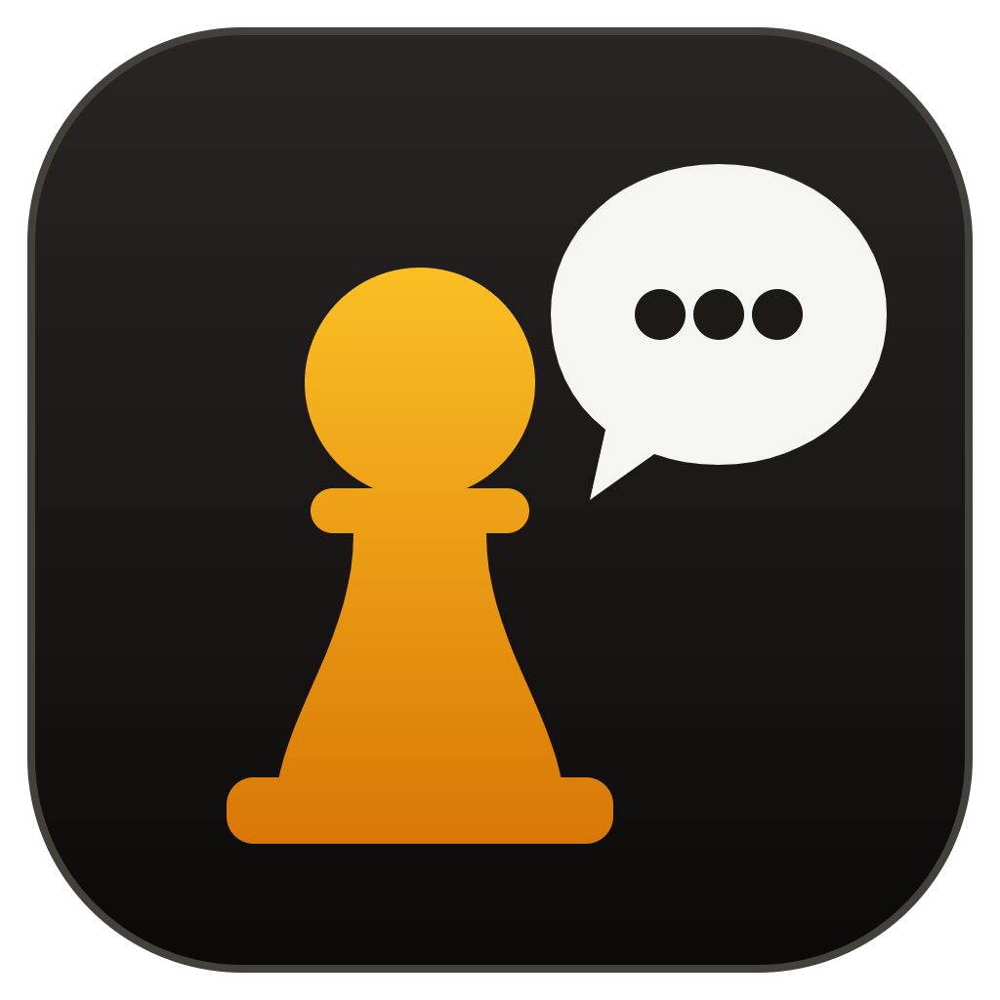
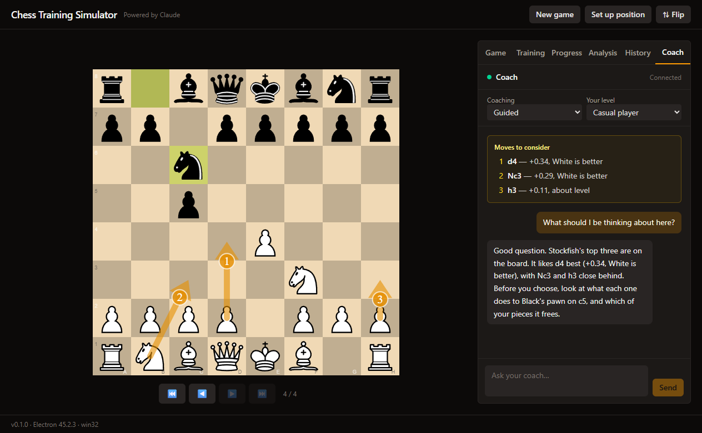
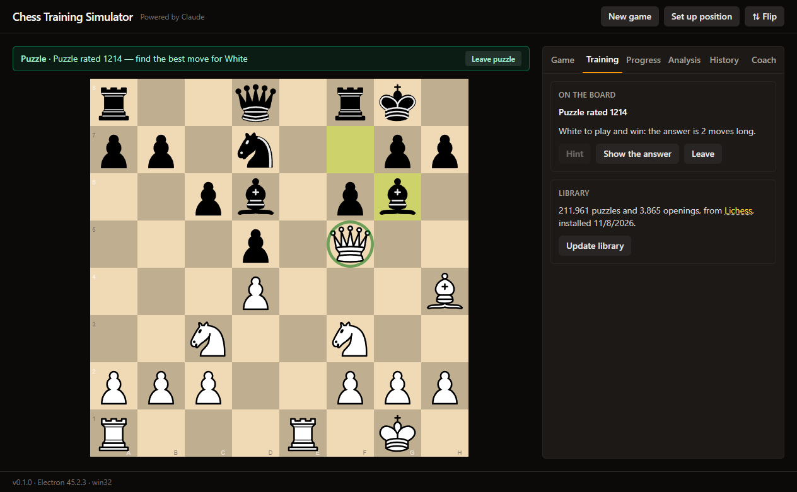
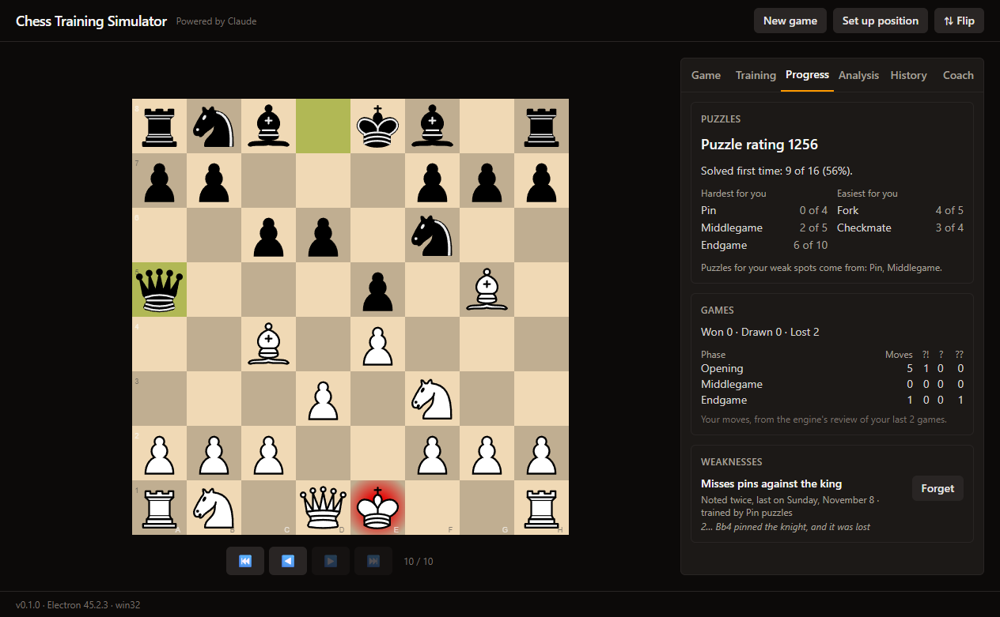

<p align="center"></p>

# Chess Training Simulator

[](https://github.com/Blankscreen-exe/chess-training-simulator/actions/workflows/ci.yml)
[](LICENSE)

A desktop chess trainer where Claude coaches you: it shows you your options before a move, tells
you what went right or wrong after it, replays "what if" lines on the board, and gives you puzzles,
openings and reviews. Claude connects from your own Claude Code and uses your own Claude plan, so
there is no API key, and your chats stay in Claude Code's transcripts on your computer.

Stockfish plays and judges the chess; Claude never acts as the engine. Every chess fact the coach
gives comes from Stockfish, through the app's tools, and every line it makes up is checked move by
move before you see it.

For Windows, macOS and Linux. Powered by Claude; not made by Anthropic.



## What it does

- **Play Stockfish** at eight strengths, from the start or from a position you set up, with its
  best lines as arrows when you want them, and every game kept to step back through.
- **Be coached as you like:** guided (your options before each move, and how each move went),
  casual (your options, never a verdict), blunder watch (only your mistakes), or silent. The coach
  plays lines out on the board, sets up positions, and can play you itself.
- **Train:** Lichess's puzzles by theme and by the piece that wins, lessons the coach builds from
  them, openings played through, and a review of every game once it ends.
- **See your progress:** a puzzle rating, the themes you find hard, where in your games you go
  wrong, and the weaknesses the coach notes, with puzzles aimed at them. Puzzles you miss, and the
  worst mistakes in your own games, come back for you to practise, spaced out over days.

| Training                                                          | Progress                                                                               |
| ----------------------------------------------------------------- | -------------------------------------------------------------------------------------- |
|  |  |

## Installing it

Download the installer for your system from the
[releases page](https://github.com/Blankscreen-exe/chess-training-simulator/releases). The builds
are not signed yet, so Windows and macOS warn once before the first run;
[docs/install.md](docs/install.md) says how to get past that, where your data is kept, and how to
uninstall.

## Connecting the coach

The coach is Claude, in your own [Claude Code](https://code.claude.com/docs/en/overview). The
app runs a small MCP server on your computer, at `http://127.0.0.1:8765/mcp`, which only this
computer can reach and which refuses requests from web pages.

1. Start the app.
2. Add the coach to Claude Code, once:

   ```sh
   claude mcp add --transport http --scope user chess-coach http://127.0.0.1:8765/mcp
   ```

   Running from source, Claude Code started in this project's folder finds it by itself, through
   `.mcp.json`.

3. Start `claude`, and allow the coach's tools when asked, or all at once with `/permissions` and
   the rule `mcp__chess-coach`.
4. Say "let's train". The Coach tab in the app shows it connected, and you chat with it there.

In the Coach tab, choose how closely it coaches:

| Mode          | What the coach does                                              |
| ------------- | ---------------------------------------------------------------- |
| Guided        | Shows your options before each move, and says how each move went |
| Casual        | Describes your options, and never judges the moves you make      |
| Blunder watch | Speaks up only when you make a mistake                           |
| Silent        | Says nothing about the game unless you ask                       |

You can also ask in the chat: "show me a trick with the bishop", "what happens if my rook goes to
e7?", "give me a puzzle", "work on my weak spots", "let's practise my mistakes", "show me a few
good openings", "review that game", "let's start another game", "play me yourself".

Claude waits for you through a tool call that returns every 40 seconds or so; each return is a
small turn on your plan. After ten quiet minutes it stops waiting, and the app shows the coach as
paused; say "continue" in Claude Code to bring it back. Set `CHESS_COACH_PORT` to run the app on
another port (and add the coach with that port).

## Privacy

Your games, progress and settings stay on your computer. The app goes online only to install
the puzzle library, from Lichess. The coach's server answers only this computer, and your chats
stay in Claude Code's transcripts. See [docs/install.md](docs/install.md#your-data).

## Running it from source

You need [Node.js](https://nodejs.org/) 24 or later and [pnpm](https://pnpm.io/) 11.

```sh
pnpm install
pnpm dev
```

| Command            | What it does                                                    |
| ------------------ | --------------------------------------------------------------- |
| `pnpm dev`         | Runs the app, reloading as you change the code                  |
| `pnpm build`       | Builds the app into `out/`                                      |
| `pnpm package`     | Builds installers for this platform into `release/`             |
| `pnpm package:dir` | Builds an unpacked app into `release/`, without installers      |
| `pnpm test`        | Runs the tests                                                  |
| `pnpm lint`        | Checks the code with ESLint                                     |
| `pnpm typecheck`   | Checks the types                                                |
| `pnpm format`      | Formats the code with Prettier                                  |
| `pnpm icon`        | Renders `build/icon.svg` to the `build/icon.png` installers use |

Every package is bundled into the app by Vite, for the main process as for the page, so all of
them go in `devDependencies`. `dependencies` is only for a package that cannot be bundled, which
electron-builder would then copy into the app whole; there are none. Stockfish is the exception to
both: it runs in its own process, and `electron-builder.yml` copies just the one build of it the
app uses.

## Releasing

1. Move the changes from the top of [CHANGELOG.md](CHANGELOG.md) under a section for the new
   version, and set that version in `package.json`.
2. Commit, then tag and push: `git tag v0.1.0 && git push origin main v0.1.0`.
3. The [release workflow](.github/workflows/release.yml) runs the checks, builds the installers
   on Windows, macOS and Linux, and drafts a GitHub release with them, their checksums and the
   version's notes from the changelog. Read the draft, then publish it.

## How the code is organised

The main process decides everything about the chess; the page only shows it and asks. They meet
through one typed contract.

| Folder              | What is in it                                                                                                                    |
| ------------------- | -------------------------------------------------------------------------------------------------------------------------------- |
| `src/shared`        | The vocabulary both sides use: chess types and their allowed values, engine levels, notation helpers, and the IPC contract       |
| `src/main/chess`    | The rules, through chess.js: legal moves, checking positions, how games end                                                      |
| `src/main/games`    | A game, its storage in SQLite, and the service that plays it against the engine                                                  |
| `src/main/engine`   | Stockfish: the UCI protocol, strength levels, and running it in its own process                                                  |
| `src/main/analysis` | The engine's best lines for a position                                                                                           |
| `src/main/library`  | The puzzle and openings library: reading Lichess's files, installing them, and finding puzzles and openings                      |
| `src/main/puzzles`  | A puzzle being solved, and the player's tries at them                                                                            |
| `src/main/reviews`  | The engine's review of each game as it ends, kept, and the positions of its worst mistakes taken to practise                     |
| `src/main/profile`  | The player's profile: puzzle rating, themes, weaknesses, and the spaced practice of missed positions                             |
| `src/main/coach`    | The coach's MCP server: who may connect, its tools and instructions, and the chat and events it passes between player and Claude |
| `src/main/ipc`      | Checking every request from the page against a schema, and answering it                                                          |
| `src/main/storage`  | The SQLite database, its migrations, and settings                                                                                |
| `src/preload`       | `window.api`, built from the contract                                                                                            |
| `src/renderer/src`  | The React app: `state` (what the board shows, as a reducer), `hooks`, `components`, and `lib` (pure helpers)                     |
| `src/test-support`  | Building blocks for tests, such as games played with chess.js                                                                    |

Adding a request from the page means three edits, each checked by the compiler: the channel in
`src/shared/ipc.ts`, its argument schema in `src/main/ipc/schemas.ts`, and its handler in
`src/main/services.ts`.

## Licence

GPL-3.0. See [LICENSE](LICENSE) and [THIRD_PARTY_NOTICES.md](THIRD_PARTY_NOTICES.md).
